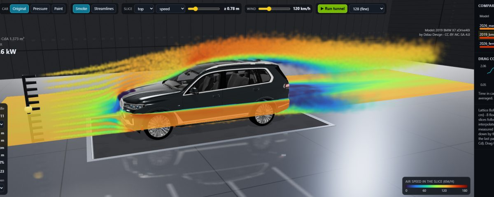

<!-- esasim: cover -->

<!-- /esasim: cover -->

# Virtual wind tunnel

An interactive wind tunnel for car models, in the spirit of NVIDIA's *Digital Twins for Fluid Simulation* blueprint, run on your own GPU workers.

## How to use it

1. **Upload your cars**: in *Data*, open the dataset **Car models** and add GLB/glTF, STL, OBJ, PLY or OFF files (one car per file). Orientation and units are found automatically: the longest side is the car's length, glTF files are Y-up (others Z-up), the taller end is taken as the rear, and sizes in mm or cm are scaled to metres. If a car comes out the wrong way round, set *Length axis*, *Up axis*, *Nose at* or *Units* on the Wind tunnel block.
2. **Run** the flow *1 · Wind tunnel* (or press **Run tunnel** in the View). Each car is placed on the road of a virtual tunnel and simulated in turn on the GPU.
3. **Study** them in the View:
   - **Car**: *Original* shows the model with its own materials (GLB/glTF), *Pressure* paints the surface pressure (Cp) on it, *Paint* shows it in a neutral finish.
   - **Smoke wand**: a rake of smoke nozzles in front of the car. Drag the wand's handle in the 3D view, or use the sliders, to move it in real time: the smoke follows the computed flow (interpolated from the simulation) and spreads where the flow is turbulent.
   - Streamlines, centre or horizontal flow slices (speed or pressure), a wind-speed slider for drag force and power, and a table that ranks all models by drag.

## What it computes

- **Solver**: lattice Boltzmann method (D3Q19) with a regularized collision and a Smagorinsky LES model, written in NVIDIA Warp and run on the worker's GPU (CPU fallback). Partial-slip wall model on the body, velocity inlet, pressure outlet with a sponge zone, slip floor (like a rolling road), periodic side walls, static wheels.
- **Grid**: *Resolution* cells per car length (64 quick, 96 standard, 128 fine, 160 very fine). At 96 a car is about 6 to 11 million cells and takes about a minute on an RTX 3070 or V100. Race cars with thin wings benefit from *fine*.
- **Outputs**: `results.csv` (Cd, Cl, side force, CdA, drag, lift and drag power at the chosen speed), per-car `*_cp.ply` surfaces coloured by pressure, the View's files (`*.tunnel.json.gz`, `*.field.bin.gz` with the mean velocity, pressure and turbulence around the car, and the original GLB), and a Markdown report.

## Accuracy

This is a fast, coarse-grid digital twin for comparing designs, not certification CFD. Absolute Cd values depend on resolution; compare cars with each other at the same settings, and use finer grids for closer numbers.

## Model credits

The car models used in this project come from [Sketchfab](https://sketchfab.com) and belong to their authors:

- **BMW**: [Ddiaz Design](https://sketchfab.com/ddiaz-design)
- **2021 Lamborghini Countach LPI 800-4**: [Lexyc16](https://sketchfab.com/Lexyc16)
- **2026 Mercedes W17**: [Dave Love SketchFab](https://sketchfab.com/Tyler_Dave) ([model page](https://sketchfab.com/3d-models/2026-mercedes-w17-b806f1e70aa343219e7158169549b97b), CC-BY-4.0)

Please respect each model's licence on Sketchfab when sharing results.

<!-- esasim: files of the project -->

---

An [EsaSim](https://esacode.com/) project of the workspace Gianluca De Novi's workspace (automotive).

### Blueprints in this repository

- [1 · Wind tunnel](blueprints/1-wind-tunnel.json) · 7 blocks · version 3

### Workspace blocks it uses

- [Wind tunnel (GPU CFD)](blocks/ws-wind-tunnel-gpu-cfd) · version 3
- [Wind tunnel view](blocks/ws-wind-tunnel-view) · version 2

The data the blueprints read (Car models) stays in EsaSim.

Keys pasted in blocks (secret settings) are not saved here, nor are the team and the results of runs.
